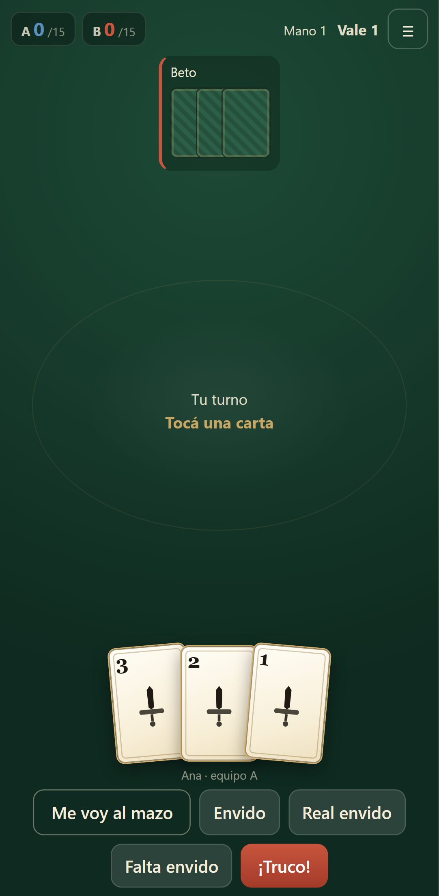
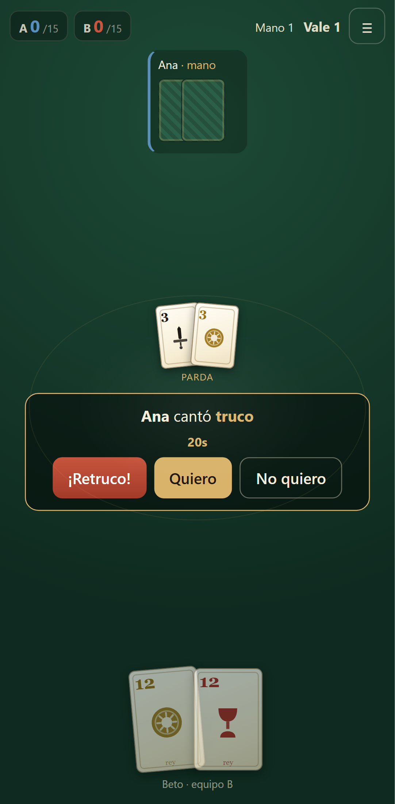
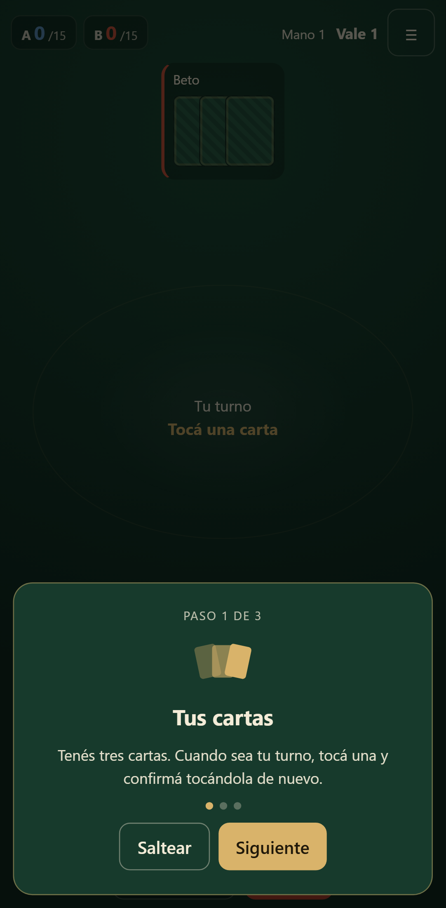
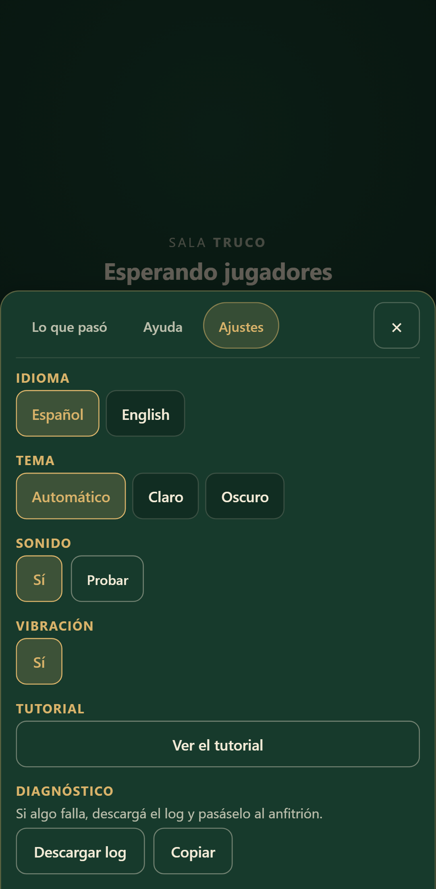
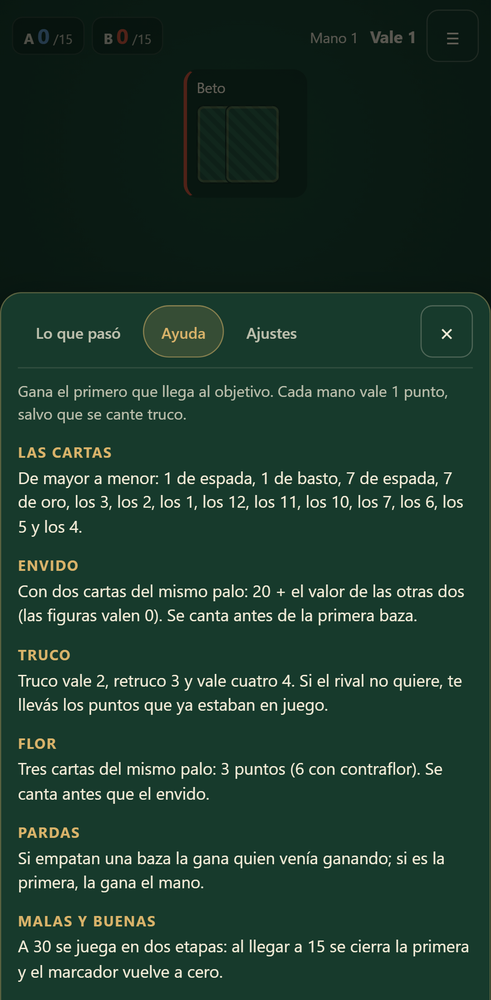
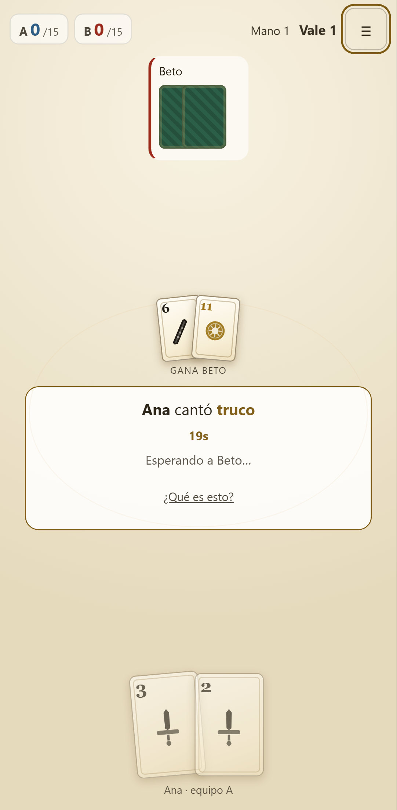
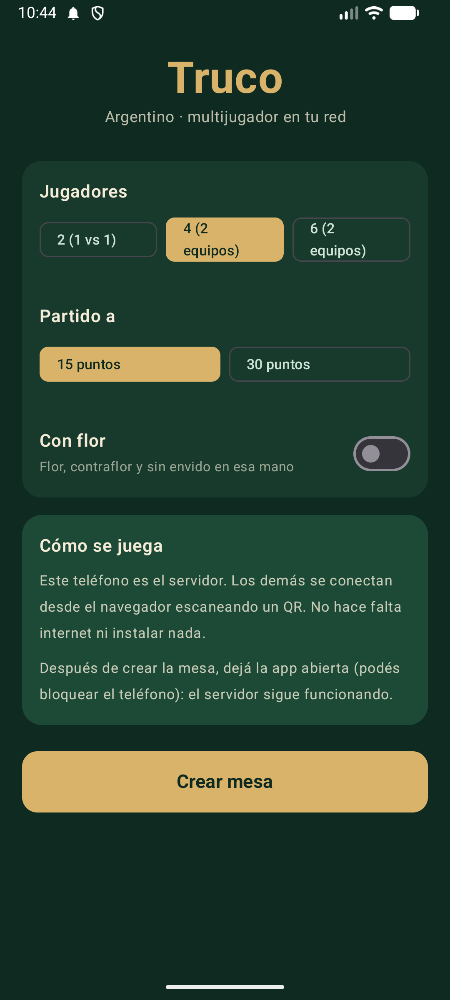
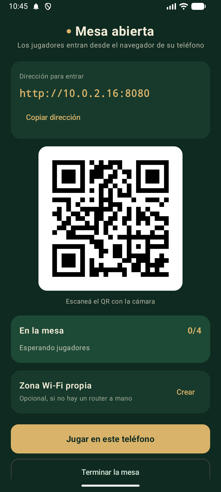
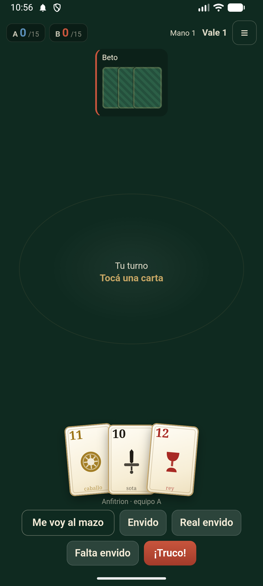

# Truco Argentino — Multijugador LAN

Juego de **Truco Argentino** para Android. La app anfitriona levanta un servidor HTTP + WebSocket
dentro del teléfono; los demás jugadores se conectan **desde el navegador** de sus propios móviles
(no instalan nada). 2, 4 o 6 jugadores, sin internet, sin cuentas.

```
┌──────────────┐   Wi-Fi / hotspot   ┌───────────────┐
│  App Android │◄──── ws://ip:8080 ─►│  Navegador    │
│  (host)      │◄───────────────────►│  jugador 2    │
│  servidor    │◄───────────────────►│  jugador 3    │
│  + mesa      │◄───────────────────►│  jugador 4-6  │
└──────────────┘                     └───────────────┘
```

## Documentación

| Doc | Contenido |
|-----|-----------|
| [docs/00-PLAN.md](docs/00-PLAN.md) | Objetivo, alcance, MVP, riesgos, definición de terminado |
| [docs/01-REGLAS.md](docs/01-REGLAS.md) | Reglas del juego, variantes y modelo de dominio |
| [docs/02-ARQUITECTURA.md](docs/02-ARQUITECTURA.md) | Componentes, red, ciclo de vida Android, reconexión |
| [docs/03-STACK.md](docs/03-STACK.md) | Tecnologías recomendadas, alternativas y ADRs |
| [docs/04-PROTOCOLO.md](docs/04-PROTOCOLO.md) | Mensajes WebSocket, secuencias, errores |
| [docs/05-ROADMAP.md](docs/05-ROADMAP.md) | Fases, entregables y criterios de aceptación |
| [docs/06-INSTALACION.md](docs/06-INSTALACION.md) | Instalar el APK, crear la mesa, problemas comunes |
| [CHANGELOG.md](CHANGELOG.md) | Qué trae la 1.0.0 |

## Instalar y jugar

El APK de release está en `app/build/outputs/apk/release/app-release.apk` (firmado, ~2,2 MB, Android 8+).
Se pasa al teléfono anfitrión, se instala habilitando "instalar apps desconocidas" y listo: los demás
entran desde el navegador con el QR. Paso a paso, permisos y problemas comunes:
[docs/06-INSTALACION.md](docs/06-INSTALACION.md).

## Decisiones tomadas

| # | Decisión | Estado |
|---|----------|--------|
| D-01 | **Kotlin + Ktor** embebido (CIO) para el host | ✅ confirmado |
| D-02 | Mesa del anfitrión en **WebView** contra `127.0.0.1` (una sola UI) | ✅ confirmado |
| D-05 | 6 jugadores = **2 equipos de 3** (compañeros alternados 0-2-4 vs 1-3-5) | ✅ confirmado |
| D-08 | Distribución por **APK directa** (sin Play Store) | ✅ confirmado |

## Capturas

**Cliente web (cualquier teléfono)**

<table>
<tr>
<td><br><sub>La mesa</sub></td>
<td><br><sub>Un canto</sub></td>
</tr>
</table>

**Pulido (Fase 6)**

<table>
<tr>
<td><br><sub>Tutorial la primera vez</sub></td>
<td><br><sub>Idioma, tema, sonido y log</sub></td>
<td><br><sub>Reglas desde la mesa</sub></td>
<td><br><sub>Tema claro</sub></td>
</tr>
</table>

**App Android (anfitrión)**

<table>
<tr>
<td><br><sub>Configurar</sub></td>
<td><br><sub>QR para entrar</sub></td>
<td><br><sub>La mesa en el teléfono</sub></td>
</tr>
</table>

## Estado

- [x] Fase 0 — Planificación y decisiones documentadas
- [x] Fase 1 — Motor de reglas (Kotlin puro, 43 tests, 480 partidas aleatorias)
- [x] Fase 2 — Protocolo y servidor Ktor (16 tests de integración por WebSocket)
- [x] Fase 3 — Cliente web jugable + E2E en navegador real
- [x] Fase 4 — App Android: servicio en primer plano, QR, hotspot, WebView
- [x] Fase 5 — Contraflor, malas y buenas a 30, abandono fino
- [x] Fase 6 — Pulido: i18n es/en, tutorial, ayuda, sonido, tema claro/oscuro, a11y, log
- [x] Fase 7 — Release: APK firmada (v2), R8, guía de instalación y changelog

## Cómo correr lo que hay hoy

Requisitos: JDK 17+ (probado con 21), Node 20+ (probado con 24) y Android SDK con `platforms;android-37`.

```bash
# 1) Cliente web (una vez, o cuando cambies el front)
cd web && npm install && npm run build && cd ..

# 2) APK de debug para probar en el teléfono anfitrión
./gradlew :app:assembleDebug
adb install -r app/build/outputs/apk/debug/app-debug.apk

# 3) APK de release (firmada, con R8) para repartir
cp keystore.properties.example keystore.properties   # poné las claves reales
./gradlew :app:assembleRelease
# → app/build/outputs/apk/release/app-release.apk (~2,2 MB)

# 4) O probarlo con la PC como servidor
./gradlew :server:run            # http://localhost:8080
```

En la app: elegí jugadores y partido → **Crear mesa** → los demás escanean el QR (o abren la
`http://<ip>:8080` que muestra la pantalla) → **Estoy listo**. La guía completa para quien juega
(instalación, hotspot, problemas comunes) está en [docs/06-INSTALACION.md](docs/06-INSTALACION.md).

```bash
# Tests
./gradlew :engine:test        # 53 tests del motor (incluye flor/contraflor y malas y buenas)
./gradlew :server:test        # 18 tests de protocolo y sala (incluye abandono)
cd web && npm test            # 15 tests del cliente (i18n, preferencias, diagnóstico)
cd e2e && npx playwright test # 3 E2E reales en Chromium, cada uno con su servidor
```

### Desarrollo del front con recarga en caliente

```bash
./gradlew :server:run          # terminal 1: backend en :8080
cd web && npm run dev          # terminal 2: Vite en :5173 con proxy a /ws y /api
```

El servidor también acepta `TRUCO_PUERTO` y `TRUCO_JUGADORES` (por defecto 8080 y 4).
`curl http://localhost:8080/api/info` muestra el estado de la sala.
